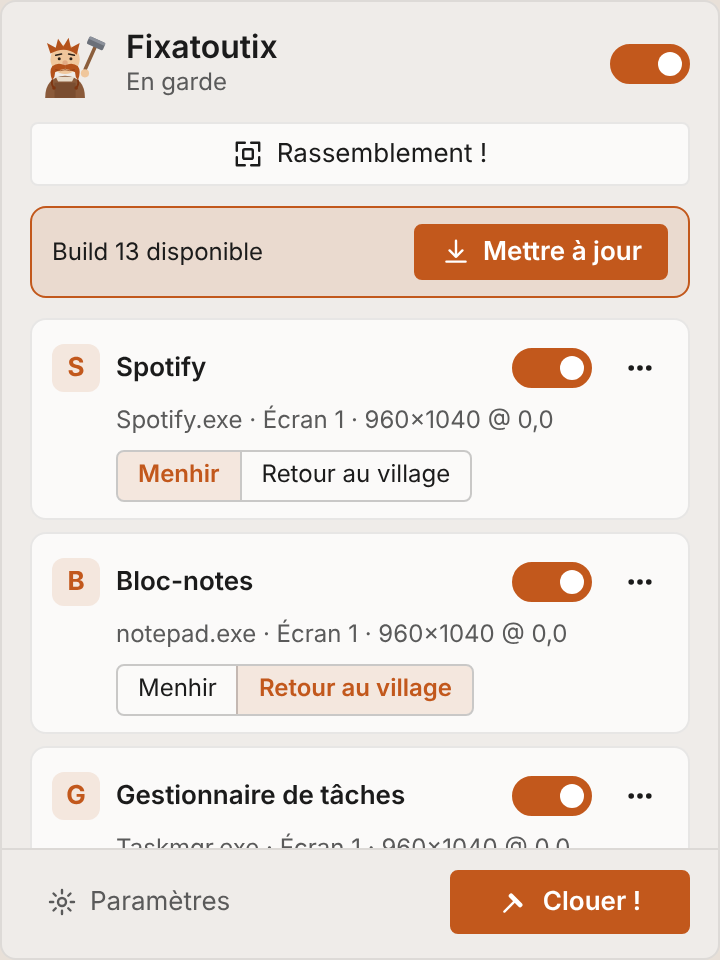
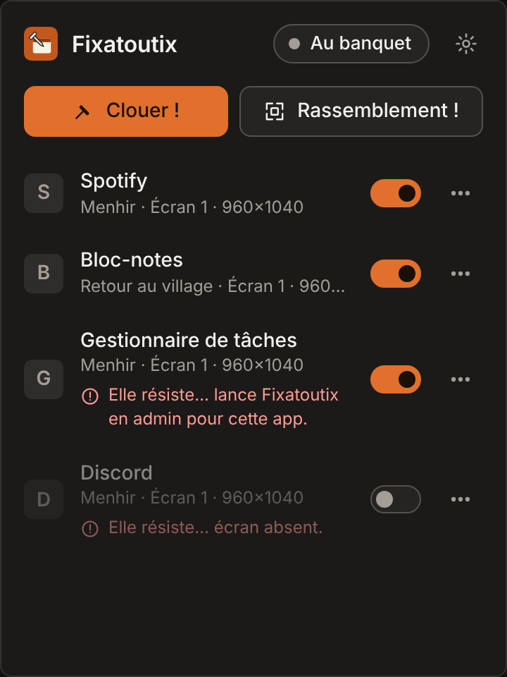

<div align="center">


# Fixatoutix

**By Toutatis, your windows will never move again!**

A tiny Windows 11 tray app that nails a window to a position and size, and puts it back whenever it moves or reappears.

[](https://github.com/KrustyLeBot/Fixatoutix/actions/workflows/build.yml)
[](https://github.com/KrustyLeBot/Fixatoutix/releases/latest)


</div>

---

Snap your windows with Windows 11, press **Ctrl+Alt+F**, and forget about them. Next time Spotify, Notepad or
your terminal shows up, it lands exactly where you nailed it, even if the app insists on opening somewhere
else, even after a reboot, a docking-station dance or a monitor going to sleep.

> *Snap it, Fixatoutix nails it.* &nbsp;·&nbsp; *Solid as a menhir.* &nbsp;·&nbsp; *What is nailed stays nailed.*

<p align="center">
  
  &nbsp;
  
</p>

<sub>The panel with sample data (rendered from the real UI). The app itself is in French, with an English
option in the settings.</sub>

## Highlights

- **One portable `.exe`.** No installer, no admin rights, no taskbar button. It lives in the notification area.
- **Nail in one keystroke.** `Ctrl+Alt+F` (configurable) nails the window in front, with its exact visible
  rectangle, on the right screen.
- **Two ways to keep it there.** *Menhir* puts the window back after every move; *Retour au village* only puts
  it back when it reappears and lets you move it freely afterwards.
- **Built for Windows 11.** Compensates for the invisible resize borders (DWM frame bounds), works across
  monitors with different scaling (Per-Monitor V2 DPI), and never moves a window while you are dragging it.
- **Gets out of your way.** About 0 % CPU at rest. The panel is a real WebView2 window, but it is created when
  you open it and destroyed when it closes, so an idle Fixatoutix holds no browser process.
- **Updates itself.** Checks GitHub for a newer build and installs it in one click. Nothing else touches the
  network.
- **Private.** No telemetry, no account, no cloud. Your rules are one JSON file you can read.

## Install

1. Download **`Fixatoutix.exe`** from the [latest release](https://github.com/KrustyLeBot/Fixatoutix/releases/latest).
2. Put it anywhere and run it. The icon appears in the notification area (behind the `^` chevron: drag it out
   to keep it visible).
3. Optional: *Settings → Démarrage automatique* to start it with Windows.

Requirements: Windows 11 x64 (Windows 10 should work) with the WebView2 runtime, which Windows 11 ships with.

> **Windows SmartScreen** may warn about an unsigned app the first time. The exe is built by
> [GitHub Actions](.github/workflows/build.yml) straight from this repository, and the SHA-256 of every build is
> in its release notes.

### Portable mode

If a file named `fixatoutix.json` sits next to the exe, Fixatoutix uses it as its config. Otherwise it uses
`%APPDATA%\Fixatoutix\config.json`. Copy the exe and that file to a USB stick and your layout follows you.

## Using it

| You want to | Do this |
|---|---|
| Nail the window in front | `Ctrl+Alt+F`, or tray menu → *Clouer la fenêtre active* |
| Nail any open window | Open the panel (left-click the tray icon) → **Clouer !** → pick a window |
| Update a nailed window's position | Move it, then `Ctrl+Alt+F` again, or `⋯` → *Reclouer ici* |
| Put everything back right now | **Rassemblement !** (panel or tray menu) |
| Pause everything | Switch to **Au banquet**; switch back to **En garde** to re-apply instantly |
| Reorder rules | Drag them in the panel: the first matching rule wins |
| Remove a rule | `⋯` → *Déclouer* |

A second launch of the exe simply opens the panel of the running instance.

### The village vocabulary

| Concept | In the app |
|---|---|
| Create a rule for a window | **Clouer !** |
| A rule / a pinned window | **Fenêtre clouée** |
| Put back after every move | **Menhir** |
| Put back only when it reappears | **Retour au village** |
| Re-apply every rule now | **Rassemblement !** |
| Active / paused | **En garde** / **Au banquet** |
| Delete a rule | **Déclouer** |
| Update a rule's rectangle | **Reclouer ici** |
| Something went wrong | **Elle résiste…** (and why) |

### When a window resists

- **Run as administrator.** Windows blocks a normal process from moving an elevated one. The rule shows
  *"Elle résiste… lance Fixatoutix en admin pour cette app."* Run Fixatoutix as administrator if you need that
  app; it never asks for elevation on its own.
- **Screen unplugged.** The rule is left alone (no wild jump to another monitor) and shows *"écran absent"*
  until the screen is back.
- **Maximized or minimized.** Left alone. Each rule has a *force restore* option in the config if you want
  maximized windows brought back to their rectangle.
- **A window that fights back.** At most three corrections per five seconds per window, then Fixatoutix gives up
  quietly (and logs it) instead of starting a tug of war.

## How it works

- `SetWinEventHook` (out of context) listens for windows being shown or created, restored from minimized,
  finishing a move or resize, and moving programmatically (debounced 300 ms).
- A rule matches on the **exe** (case-insensitive), optionally the **window class** and a **title regex**.
- **One rule is one window.** Several windows of the same app (several Edge windows, say) each get their own
  position, per window and not per tab. An open window claims a free matching rule and keeps it while it lives;
  with several free ones it takes the rule whose rectangle is closest to where the window is, since apps reopen
  near where they were. Nail a second Edge window and you get a second rule ("Edge 2"). A window with no free
  rule left is left alone.
- Placement uses `SetWindowPos` after measuring the gap between `GetWindowRect` and the DWM extended frame
  bounds, so the *visible* rectangle lands exactly where it was nailed (±1 px). Our own moves are recognised
  and ignored, so there is no feedback loop.
- Display changes and DPI changes re-evaluate every rule.

### Config

```jsonc
{
  "schema": 1,
  "settings": { "shortcut": "Ctrl+Alt+F", "language": "fr", "paused": false, "checkUpdates": true },
  "rules": [{
    "id": "7c9e6679-7425-40de-944b-e07fc1f90ae7",
    "enabled": true,
    "label": "Spotify",
    "match": { "exe": "Spotify.exe", "className": "Chrome_WidgetWin_1", "titleRegex": null },
    "rect": { "x": 0, "y": 0, "w": 960, "h": 1040 },   // visible bounds, physical pixels
    "monitor": { "deviceName": "\\\\.\\DISPLAY1" },
    "mode": "lock",                                     // "lock" = Menhir, "restore" = Retour au village
    "forceRestore": false
  }]
}
```

Writes are atomic (temporary file, then rename). A corrupt config is copied to `.bak`, Fixatoutix starts from
scratch and tells you. Logs live in `%LOCALAPPDATA%\Fixatoutix\logs` (1 MB, rotated).

## Updates

Fixatoutix uses the same scheme as my other apps (Mémento, GitEnough): the CI publishes a single release tagged
`latest`, titled `Fixatoutix build <N>`, where `<N>` is the CI run number stamped into the exe at compile time.

- 25 seconds after start, then every 6 hours, the app asks the GitHub API for that release. This is the **only**
  network request it ever makes, and it can be switched off in the settings.
- If `N` is higher than the running build, a banner and a tray menu entry offer the update.
- *Mettre à jour* downloads the exe next to the running one, checks its **size and SHA-256** against what GitHub
  published, renames the running exe to `Fixatoutix.exe.old`, moves the new one into place and restarts. If
  anything fails, the working exe is put back. The `.old` file is deleted on the next start.

## Building

**The exe is built by CI, and only by CI.** Every push to `main` runs
[`.github/workflows/build.yml`](.github/workflows/build.yml) on a Windows runner: unit tests, a release build, a
self-test of the built exe (DPI awareness from the manifest, monitors, window enumeration, DWM bounds, icons), a
start-and-stay-alive smoke test, then the `latest` release. No binary is ever committed.

For development on a Windows machine you need the Rust toolchain only (no Node, no bundler: the UI is plain
HTML/CSS/JS in [`ui/`](ui)):

```powershell
cd src-tauri
cargo test                 # rules, config and updater logic
cargo run --features custom-protocol   # debug build with the UI embedded
```

```
src-tauri/
  src/
    main.rs        Tauri setup, plugins, single instance, startup flags
    engine/        hooks.rs (SetWinEventHook), apply.rs (placement + anti-loop), win.rs (Win32 helpers)
    rules.rs       rule model and matching
    config.rs      load/save, portable vs %APPDATA%, atomic writes
    actions.rs     nail, list windows, pause, autostart, update
    commands.rs    what the panel can call
    tray.rs, ui.rs notification-area icon and menu; flyout panel and toast windows
    updater.rs     GitHub release check, download, verify, swap
  app.manifest     Per-Monitor V2 DPI awareness
ui/                the panel and the toast (HTML/CSS/JS, French + English)
branding/          logo, tray icons, logo candidates
tools/make_icons.py  regenerates every icon from the SVGs
```

### Icons

`branding/logo.svg` is the source of the app icon. To switch logo:

```bash
pip install cairosvg pillow
python tools/make_icons.py branding/candidates/05-torque.svg
```

This rewrites `src-tauri/icons/` (multi-size `.ico`, PNG, and the four tray icons: on guard / at the banquet, for
light and dark taskbars).

## A note on the universe

Fixatoutix is the blacksmith of a small Gaulish village: he nails everything that moves. The names, the
menhirs, the banquets and the mascot are generic Gaulish folklore and an original character. There is no
affiliation with, and no material from, any existing comic, film or brand.

## License

[MIT](LICENSE)
